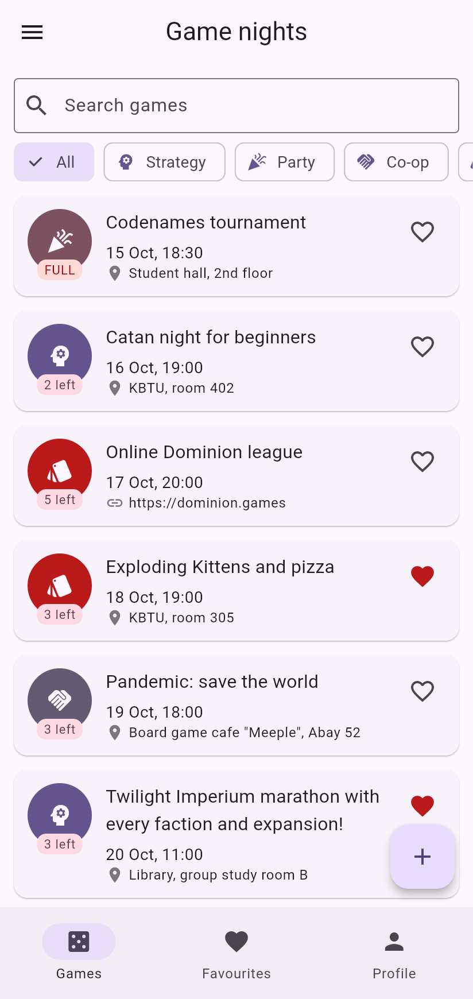
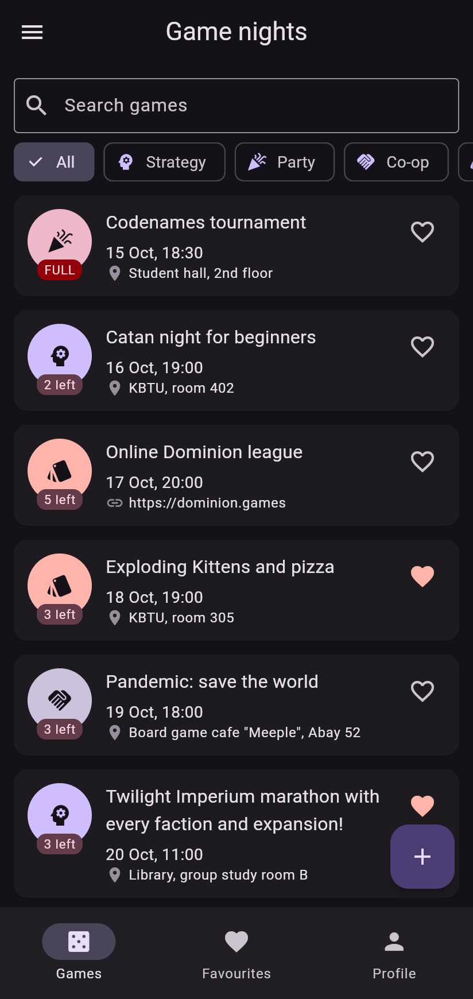
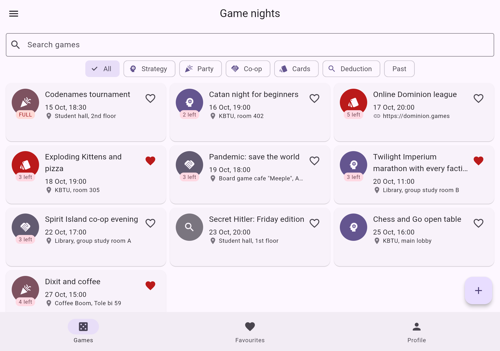

# Game Nights

Lab 1 — a board game club app. Each **game night** has a title, a category
(strategy, party, co-op, cards, deduction), a start time, a place and a number
of **seats**. Students **join** a game, their name goes on the players list, and
when all seats are taken the game is full. A game can be **online** — then the
place is a link instead of an address. All data lives in memory.

## Screenshots

| Phone, light | Phone, dark | Tablet grid |
| --- | --- | --- |
|  |  |  |

## Structure

```
lib/
  main.dart              MyApp: theme mode, routes, onGenerateRoute
  routes.dart            route names and argument classes
  models/                Game + GameCategory, Profile, Countdown
  data/seed.dart         twelve seed games, dates relative to today
  utils/format.dart      "18 Oct, 10:00" without packages
  widgets/               GameCard, GameList, EmptyState, confirm dialog
  screens/               shell with three tabs, detail, form, not found
```

## Decisions

The list of games and the profile live in the State of the shell screen,
because all three tabs and the pushed screens need the same data, and the tabs
only get it through constructor parameters and report changes through
callbacks. The detail screen gets the game together with callbacks, because
joining or deleting must change the shell's list while the detail is still open;
the form instead returns a new `Game` through `Navigator.pop`, because it only
has one result and the caller decides what to do with it. The grid is chosen by
`LayoutBuilder` and not `MediaQuery`, because what matters is the width the list
actually gets, not the size of the whole screen. `PopScope` compares a record of
the current field values with the record taken when the form opened, so the
"Discard changes?" dialog shows only when something really changed. With week
9's tools I would move the list out of the shell into a shared state object and
save it to local storage, so the data survives a restart.
